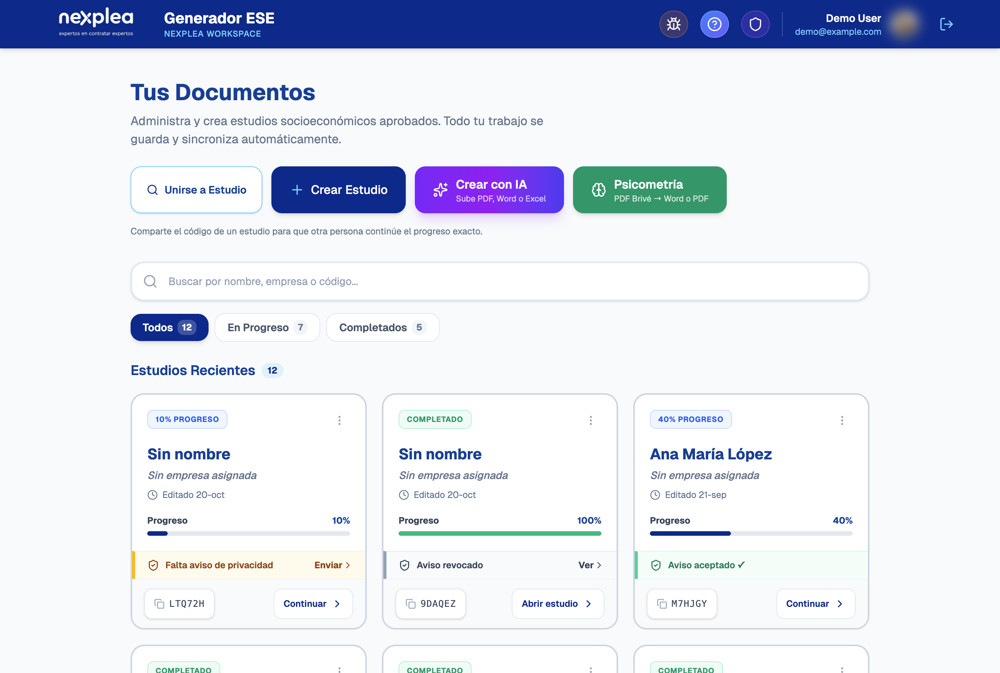
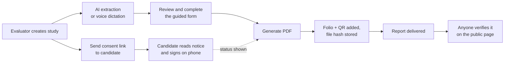

# Socioeconomic Report Generator

### From scattered candidate data to a verified, branded PDF report

> **This is a case study.** The source code is private because it is a client project. This repository explains what the product does, how it is built and the results it delivered. It contains no code to install or run.

The dashboard: study progress, privacy-consent status and shareable study codes. Personal data in the screenshot has been replaced with sample values.

## Contents

- [What it is](#what-it-is)
- [The problem](#the-problem)
- [Impact](#impact)
- [Who uses it](#who-uses-it)
- [Features](#features)
- [How a study flows](#how-a-study-flows)
- [Architecture](#architecture)
- [Data protection](#data-protection)
- [Engineering notes](#engineering-notes)
- [Author](#author)

## What it is

A web application used by an HR company in Mexico to run **socioeconomic studies** of job candidates. Evaluators capture the candidate's personal, family, academic, employment and housing information. The app then produces a formal PDF report, ready to hand to the client company.

Think of it as the evaluator's whole workbench in one place: the intake form, an AI assistant that fills it in, the candidate's signed privacy consent and the final report with a way to prove it is genuine.

## The problem

Before this tool, each study was assembled by hand:

- Data arrived in different formats (PDFs, Word files, spreadsheets, notes) and was retyped.
- The report was formatted manually, so it looked different from one evaluator to the next.
- Photos and supporting documents had to be attached one by one.
- Nothing proved that a delivered report had not been edited afterwards.

## Impact

- **80%+ faster** per client compared with the manual process.
- **10–30 clients per week** processed through the platform.
- Every report has the same structure and branding, whoever made it.

## Who uses it

| Role | What they can do |
| --- | --- |
| Evaluator | Create and edit studies, use AI capture, send consent links, generate reports |
| Administrator | Everything an evaluator does, plus approving new accounts and managing roles |
| Candidate | Opens a one-time link on their phone to read the privacy notice and sign their consent |
| Anyone with a report | Checks on a public page that a PDF is authentic and unaltered |

New accounts start as *pending* and cannot work until an administrator approves them.

## Features

### Capture

- **Guided form**: multi-step, with dynamic sections for family members, jobs and education.
- **AI extraction**: reads PDF, Word, Excel, OpenDocument, RTF or CSV files and pre-fills the form.
- **Voice dictation**: the evaluator speaks, and the AI places each answer in the right field, even in another section.
- **Cloud autosave**: work is saved automatically, and a shareable study code lets another evaluator continue exactly where the first one stopped.
- **Guided tour**: walks first-time users through the app.

### Reports

- **Branded PDF**: consistent layout, cover page, headers and watermark.
- **Embedded photos**: candidate and home photos placed inside the report.
- **Single deliverable**: supporting PDF documents merged into one file.
- **Folio and QR code**: unique on every report, linked to a public verification page.
- **Psychometric conversion**: the test provider's PDF converted into Word or PDF.

### Compliance and operations

- **Electronic privacy consent**: single-use link, typed full name and a hand-drawn signature.
- **Consent status**: shown on each study (pending, accepted, revoked).
- **Admin panel**: user approval and roles.
- **"What's new" notice**: lists user-facing changes after each release.

## How a study flows

## Architecture

| Layer | Technologies | Responsibility |
| --- | --- | --- |
| Frontend | React, Vite, Tailwind CSS | Form, dashboard, admin panel, public consent and verification pages |
| Auth and data | Firebase Auth, Firestore, Storage | Sign-in, studies, photos and attachments, role-based access rules |
| Backend | Node.js, Express | PDF generation, AI extraction, consent and verification APIs |
| AI | Gemini, with a fallback provider | Document extraction and dictation parsing into a fixed form schema |
| Reports | EJS, Puppeteer, pdf-lib, docxtemplater | HTML templates rendered to PDF, document merging, Word output |
| Deployment | Docker | One image that builds the frontend and runs the backend |

## Data protection

The app handles sensitive personal data, so it was designed with Mexico's data-protection law (LFPDPPP) in mind:

- **Express written consent** is collected electronically. The system stores the notice's version and a SHA-256 hash of its exact text, the timestamp, IP address, browser and the signature.
- **Consent and folio records are server-only.** Firestore rules deny all client reads and writes; only the backend can access them.
- **Tamper evidence.** The SHA-256 hash of each final PDF is stored when it is generated. Dropping the file on the verification page recomputes the hash in the browser and compares it.
- **Rate limiting** protects the public consent and verification endpoints.
- **AI sees only what it needs.** Photos and settings are removed before any data is sent to the model.

## Engineering notes

- Backend test suite with Node's built-in test runner, covering PDF generation, folios, consent, extraction, image handling, psychometric reports and document normalization.
- Development was tracked with small, documented task files and conventional commits.
- Release notes are generated from commit messages, so users only see changes written for them.

## Author

Designed and built by [Leoglez10](https://github.com/Leoglez10) as an independent full-stack developer.
